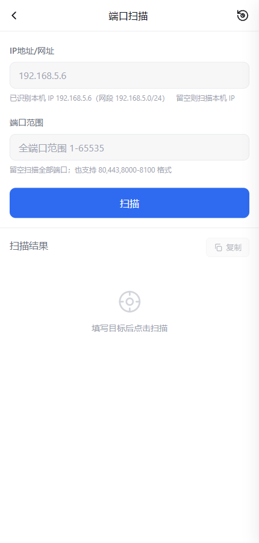
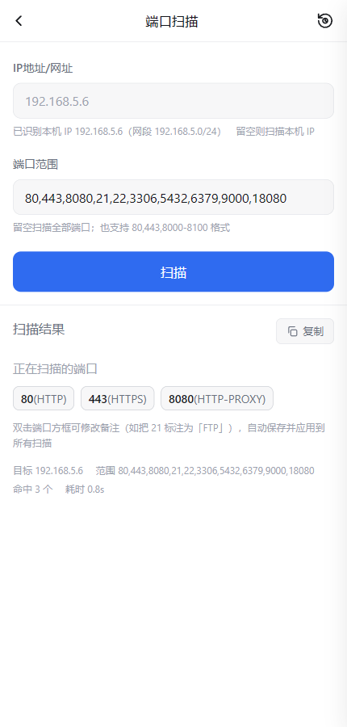
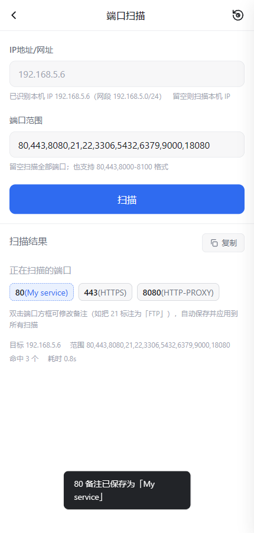
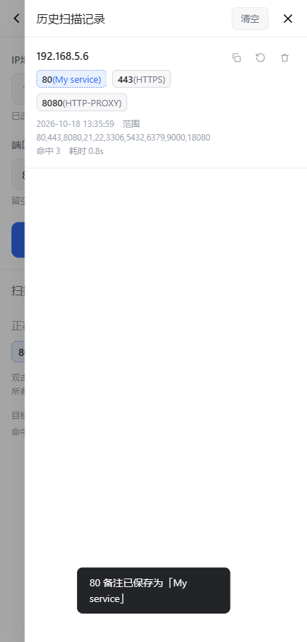
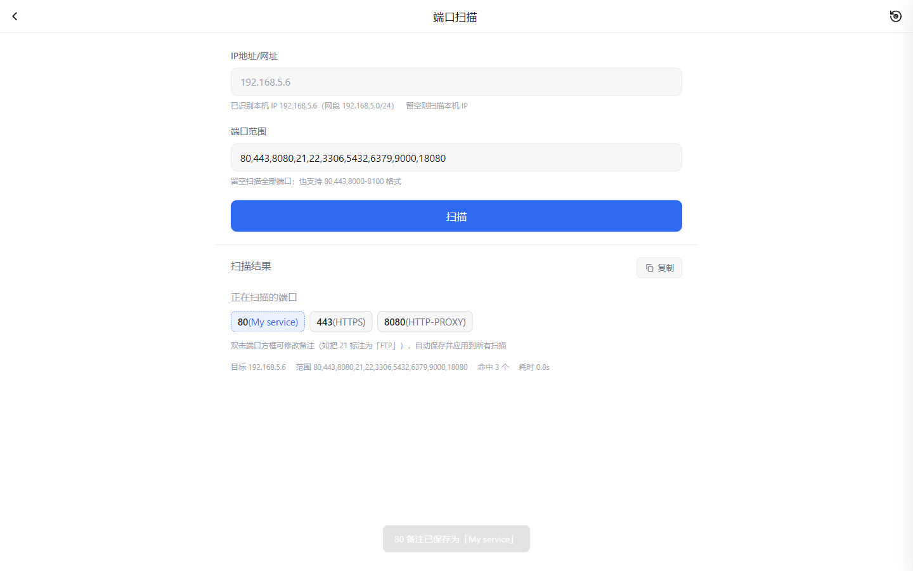

# PortScan for fnOS

[English](#portscan-for-fnos) | [中文说明](#中文说明)

**A lightweight native TCP port scanner for fnOS (FeiNiu NAS). Zero npm dependencies, zero build toolchain, single ~34 KB `.fpk` package.**

**飞牛 fnOS 原生端口扫描应用。零第三方依赖、零构建工具链，单个 fpk 仅约 34 KB，响应式界面，支持双击端口自定义备注。**

PortScan runs as a **Native** application on fnOS — no Docker, no bundled Node.js, no React/Vite/Express. The entire backend is `node:http` + `node:net`; the entire frontend is one HTML file of vanilla JavaScript.

---

<a name="中文说明"></a>
## 中文说明

飞牛 fnOS **原生应用**（非 Docker 容器）。扫描在 NAS 服务端执行，浏览器通过 SSE 实时接收进度。

- 零第三方依赖：后端只用 `node:http` / `node:net`，前端是单文件原生 JS，**不需要 `npm install`**
- 单个 fpk 仅约 34 KB，安装后启动 < 1 秒
- 复用 fnOS 统一网关（`/app/portscan`）与 Unix Socket，无需占用额外端口

## Features

### Accurate local IP detection

The grey placeholder shows your NAS **real LAN IP**, never a container address. Detection excludes `docker0`, `br-*`, `veth*`, `virbr*`, VPN tunnels and other virtual interfaces, and prefers physical NICs (verified via `/sys/class/net/<name>/device` on Linux).

> Docker bridges report `172.17.0.1` / `172.19.0.1` — a naive `os.networkInterfaces()` call picks those instead of your real network card.

### Flexible target syntax

| Format | Example |
| --- | --- |
| Single IP | `192.168.5.7` |
| CIDR block | `192.168.5.0/24` |
| IP range | `192.168.5.1-192.168.5.20` |
| Domain / URL | `example.com` |
| *(empty)* | scans the local machine |

### Flexible port syntax

Leave empty for all ports `1-65535`, or use comma and dash mixes: `80,443,8000-8100`.

### Port boxes with editable labels

Every open port is rendered as its own box with its well-known service name. **Double-click any box to attach your own note** — it then displays as `21(FTP)`. Notes are persisted per user, applied to every future scan and to history entries, and visually marked with a dashed border. Clear the text to restore the built-in name.

### Real-time progress

Progress and hits stream over SSE. Even a 1-port scan (which finishes in milliseconds) renders correctly — the server keeps the final payload so late subscribers get it replayed instead of a 404.

### History

The clock icon opens a right drawer holding up to 50 records. Copy a record, reuse its parameters, delete one, or clear all. Boxes inside history are editable too.

### Responsive & dark mode

Adapts from phone-width to desktop-width, and follows `prefers-color-scheme`.

## Screenshots

| Initial state — grey placeholder | Scan result — port boxes |
| --- | --- |
|  |  |

| Custom port label | History drawer |
| --- | --- |
|  |  |



## Installation

Download `publish/portscan.fpk` and install it manually from **App Center → Manual Install** on your fnOS device.

Requirements: fnOS ≥ 1.2.0 and the `nodejs_v22` runtime (available in App Center; fnpack resolves the dependency automatically).

## Building from source

```bash
# 1. generate app icons (uses a hand-written PNG encoder, no dependencies)
node scripts/make-icons.js

# 2. pack the .fpk (fnpack required)
FNPACK_BIN=/path/to/fnpack node scripts/build.js
```

`build.js` assembles `app/server`, writes a dependency-free `package.json`, verifies/normalizes `cmd/main` and `wizard/install` to LF line endings, invokes `fnpack build`, and collects the result into `publish/`.

## Running locally

```bash
cd src
node server.js          # http://127.0.0.1:5083/app/portscan
```

Set `HOST=0.0.0.0` to listen on all interfaces — required when testing the clipboard fallback, because `127.0.0.1` is treated as a secure context by browsers and hides the problem.

## Testing

```bash
node scripts/test-clipboard.js                    # clipboard degradation (4 scenarios)
node scripts/e2e-test.js 127.0.0.1 "80,8080,1-5"  # backend: HTTP + SSE + history + auth
CHROME_PATH=... PW_PATH=... node scripts/e2e-browser.js   # headed browser, 16 assertions
```

The browser suite runs against a **LAN IP** (not `127.0.0.1`) on purpose: it reproduces `isSecureContext === false`, which is exactly what an HTTP-deployed fnOS app sees, and it performs real clicks so `execCommand('copy')` is genuinely exercised.

## Project layout

```text
portscan-fnos/
├── src/                        # development source
│   ├── server.js               # http service, routes, SSE, persistence
│   ├── scanner.js              # target/port parsing + TCP connect pool
│   └── public/index.html       # single-file frontend (vanilla JS, no build)
├── apps/portscan/              # fpk package directory
│   ├── manifest
│   ├── cmd/                    # main + install/config/uninstall/upgrade hooks
│   ├── config/privilege        # run-as package
│   ├── config/resource         # data-share for history and labels
│   ├── wizard/install
│   └── app/ui/config           # unified gateway entry
├── scripts/
│   ├── build.js                # assemble + LF check + fnpack build
│   ├── make-icons.js           # PNG encoder (zero dependencies)
│   ├── e2e-test.js             # backend end-to-end
│   ├── e2e-browser.js          # headed browser end-to-end
│   ├── test-clipboard.js       # clipboard degradation unit test
│   └── take-screenshots.js     # README screenshots
├── assets/                     # screenshots
├── publish/portscan.fpk        # built package
└── LICENSE
```

## How it works

| Concern | Implementation |
| --- | --- |
| Runtime | `install_dep_apps=nodejs_v22`; Node is not bundled |
| Access | fnOS unified gateway at `/app/portscan` over a Unix Socket; no `service_port` |
| User isolation | History and port notes are stored per `X-Trim-Userid` |
| Privilege | `run-as=package`, least privilege |
| Scanning | `net.connect` pool, 512 concurrent, 800 ms timeout |
| Clipboard | Native API → hidden `textarea` + `execCommand` → manual prompt |
| Virtual NIC filter | Name blacklist + `/sys/class/net/*/device` probe + relaxed retry pass |
| Fast-scan race | Terminal payload is retained and replayed to late SSE subscribers |
| Host cap | 4096 hosts, to prevent accidental huge sweeps |

## Changelog

### 1.0.1

- Fix: local IP detection picked Docker bridges (`172.19.0.1`) instead of the real LAN IP.
- Fix: an empty target field returned "target is empty" instead of scanning the local machine.
- Fix: very fast scans could leave the UI stuck at "scanning" (SSE 404).
- Add: open ports are rendered as individual boxes.
- Add: double-click a port box to attach a custom, persisted note.

### 1.0.0

- First release: automatic network detection, concurrent TCP connect scanning, SSE progress, history, copy result.

## License

MIT — see [LICENSE](LICENSE).
